**Full Stack Developer** and BS.IT graduate building database-driven web applications with PHP, MySQL, HTML, CSS and JavaScript.

<table align="center" width="100%">
<tr>
<td align="center" valign="top" width="25%"><h2>🎓</h2>BS.IT graduate, Virtual University of Pakistan (2026), with a 3.64/4.0 CGPA</td>
<td align="center" valign="top" width="25%"><h2>💻</h2>Full Stack Developer: HTML, CSS, JavaScript, PHP, Python, C++, MySQL and Oracle 11g</td>
<td align="center" valign="top" width="25%"><h2>🛠️</h2>Built <b>QAMS</b>, a role-based quiz and assignment platform for admins, teachers and students</td>
<td align="center" valign="top" width="25%"><h2>🛡️</h2>Certified in Object Oriented Programming (Cisco) and Networking Fundamentals (Cisco)</td>
</tr>
<tr>
<td align="center" valign="top" width="25%"><h2>🤖</h2>Use AI-assisted coding to refine and polish my work</td>
<td align="center" valign="top" width="25%"><h2>🎬</h2>Video editing, audio editing and motion graphics</td>
<td align="center" valign="top" width="25%"><h2>🌐</h2>Languages: English, Urdu, Punjabi</td>
<td align="center" valign="top" width="25%"><h2>⚡</h2>Interests: coding, gym, exploring new things</td>
</tr>
</table>

### 📝 QAMS: Quiz and Assignment Management System
An automated platform that replaces manual paperwork in traditional education systems: it reduces paper use and eases administrative work for teachers.

| Role | What they can do |
|------|------------------|
| **Admin** | Manage teacher and student accounts, configure quiz categories, oversee system activity |
| **Teacher** | Create question banks, build and launch quizzes with deadlines, upload assignments, manually grade solutions |
| **Student** | Log in, view active quizzes and assignments, attempt quizzes with instant automated grading, submit assignment files |

**Built with:** PHP · SQL · MySQL · HTML · CSS · JavaScript · VS Code

**Backend** 
  

**Frontend** 
  

**Cloud & DevOps** 
  

**Databases** 
 

**Tools** 
 

| Area | Details |
|------|---------|
| Full stack web development | HTML, CSS, JavaScript, PHP, MySQL |
| Database work | MySQL, Oracle 11g, SQL, PL/SQL |
| Version control & cloud | Git, GitHub, Microsoft Azure |
| Role-based web applications | QAMS: admin, teacher and student workflows |
| Networking fundamentals | Networking Fundamentals (Cisco) certification |
| Programming fundamentals | Object Oriented Programming (Cisco certification), C++, Python |
| Content creation | Video editing, audio editing, motion graphics |

| Qualification | Institution | Result | Year |
|---------------|-------------|--------|------|
| BS.IT | Virtual University of Pakistan | CGPA 3.64 / 4.0 | 2026 |
| F.Sc Pre-Engineering | Govt. PGC Sahiwal | 563 / 1100 | 2022 |
| Matric (Computer Science) | Govt. High School | 896 / 1100 | 2020 |

**Certifications:**
- Object Oriented Programming (Cisco)
- Networking Fundamentals (Cisco)

 

Thanks for stopping by. ⭐ Feel free to explore my repositories.

